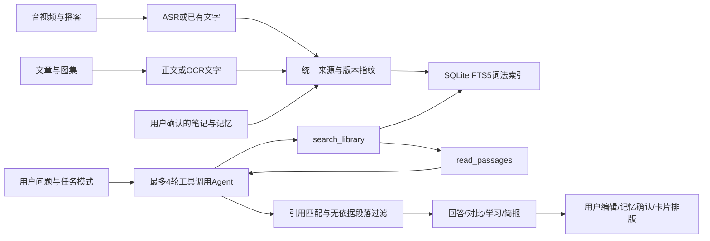

# AI应用简历能力对比地图

更新2026-10-28。只写本人真实参与和理解的部分；下面是项目证据，不是替个人经历造履历。

## 相比此前，多了什么

| 维度 | 此前拾文 | 本轮实现 | 简历上准确的说法 | 不应写成 |
|---|---|---|---|---|
| 资料层 | 音视频ASR、图文/OCR、专题笔记分散入口 | 统一来源投影、800字片段、指纹驱动FTS更新 | 混合来源的文本知识库与派生索引 | 视频/图像原生端到端理解 |
| RAG | 专题检索与单篇/选段解释 | 全部或按来源类型检索→读片段→带引用回答 | 已实现词法检索支撑的RAG闭环 | 已采用向量库或Embedding |
| Agent | 固定顺序工作流 | 模型自主选择search_library/read_passages，按观察继续检索，最多4轮 | 有界工具调用研究Agent | 任意工具自主执行、多Agent协作 |
| 工具契约 | 内部Python函数 | 标准Chat Completions tools/tool_calls、参数白名单、读取候选限制 | LLM工具调用与执行轨迹 | MCP服务、LangGraph实践 |
| 引用 | 已有原文定位与局部引文约束 | 最终引用必须来自本次读取片段并逐字匹配，移除无依据段落 | 证据约束生成与无效引用过滤 | 事实核查已保证正确 |
| 记忆 | 用户笔记、生成历史 | 用户显式确认的可编辑/移除记忆，参与检索 | 持久化、用户可控的显式记忆 | Mem0自动记忆、知识图谱、人格推断 |
| 任务 | 单篇整理与卡片创作 | 跨来源问答、对比、学习指南、自测、行动简报 | 基于同一工具集的任务化Agent应用 | 任意任务都能完成 |
| 成本与状态 | 原预算/每日额度/缓存 | 独立20元保守预留账本、共享日限额、最多4轮、版本缓存、失败恢复 | 有预算上限和可观察轨迹的Agent执行 | 已验证线上规模、SLA或零成本 |
| 验证 | 单测、局部真实联调 | 6次真实研究、19次模型调用、跨题材公开来源和记忆夹具对照 | 有真实工具调用和失败样本记录 | 六题能算通用准确率 |

## 数据如何流动

## 可用于简历的三条内容

- 构建面向音视频文稿、网页文章、图集OCR及个人笔记的统一文本知识库，复用SQLite FTS5和中英词法处理，实现来源投影、内容指纹更新与带引用RAG问答。
- 实现基于标准tool_calls的有界研究Agent，支持自主检索改写和片段读取，设置4轮执行与8段阅读上限，记录工具轨迹；约束只能引用本次读取资料，对无效引文与无依据段落进行过滤。
- 设计显式个人记忆、版本缓存及重启恢复，结合独立预算预留与共享日调用限额；用隔离库完成6次真实研究尝试、19次模型调用，保留无答案、错误引用及OCR解释越界等失败证据。

数字用于附件证据，不必全部塞进简历。不要把保守预算估算写成真实账单，也不要把用户代金券、测试夹具偏好或AI生成简报当个人业务成果。

## 岗位关联与追问

| 岗位方向 | 能展示的内容 | 应能回答的追问 |
|---|---|---|
| AI应用开发 | 多来源接入、结构化产物、编辑与卡片输出 | 为什么需要区分原文、推论与个人记忆？ |
| RAG工程 | 切片、FTS、版本指纹、引用校验 | 没有Embedding为何也是RAG？词法检索漏同义问题怎么办？ |
| Agent应用工程 | tools协议、循环、候选读取约束、预算、轨迹 | 哪个决策由模型做，哪个由程序做？为何不是固定三步提示链？ |
| 后端/全栈 | SQLite事务、异步任务、缓存、恢复、React状态展示 | 数据变化期间怎么避免混用证据？重启为什么不自动付费续跑？ |
| 模型算法研究 | 可作为应用与评测实践 | 本项目没有训练、微调或提出新检索算法，不能替代算法论文与模型实验 |

值得讲清的失败：不存在的实验编号场景中，模型并非天然可靠拒答，而是程序移除了7处无有效引用内容；有引用也可能推论越界。当前小样本不支持宣称幻觉率降低多少。

## 证据文件

- 核心：personal_kb.py；页面：frontend/src/Knowledge.tsx。
- 隔离后端测试：tests/test_personal_kb.py；前端流程：frontend/tests/knowledge.test.tsx。
- 真实试验及带原文结果仅在忽略的runtime/knowledge-agent-validation-20261028，不提交个人资料。
- 使用说明与实测：PERSONAL_AI_GUIDE_20261028.md；候选取舍：PERSONAL_AI_RESEARCH_20261028.md。
- 原有面试材料PROJECT_INTERVIEW_GUIDE.md保留历史技术边界；其“专题RAG未完成”的旧描述不应取代本轮新增统一库RAG的实际范围。
